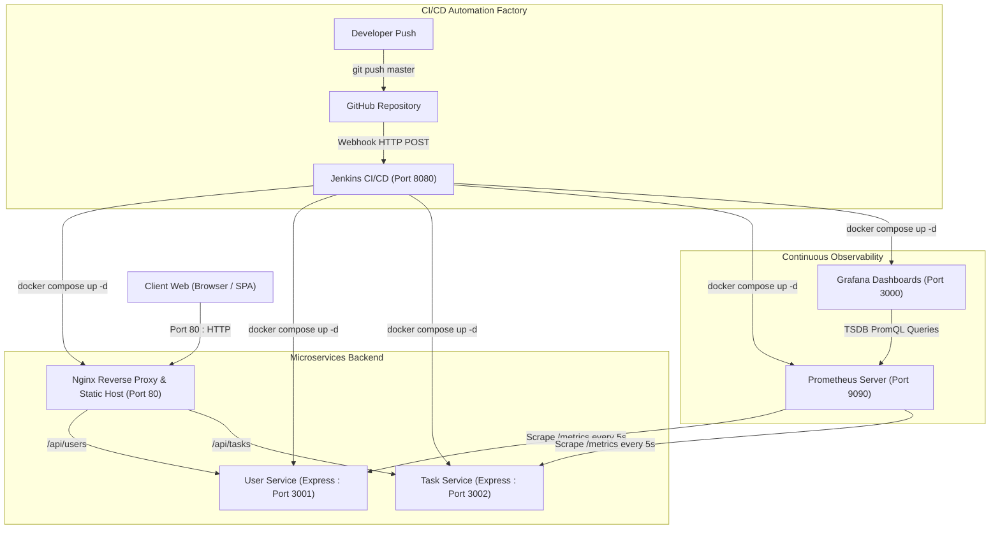
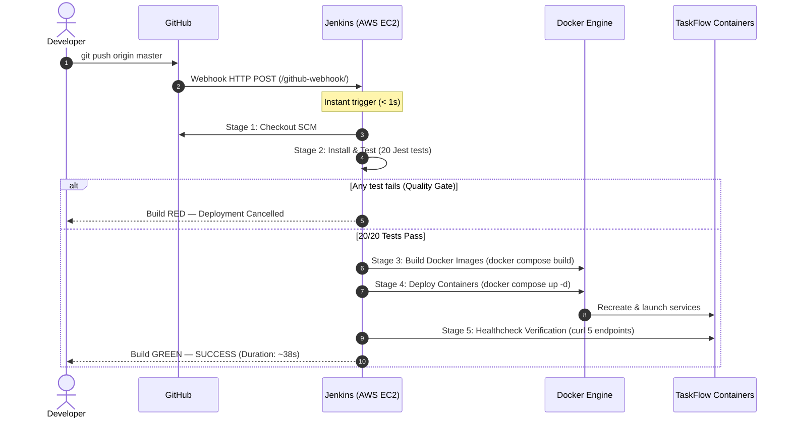

# 🚀 TaskFlow — Cloud-Native DevOps & Microservices Platform

[](http://34.206.71.95:8080/job/TaskFlow-Pipeline/)
[](https://www.docker.com/)
[](https://aws.amazon.com/)
[](https://prometheus.io/)
[](https://grafana.com/)
[](https://nodejs.org/)
[](https://jestjs.io/)
[]()

> **Projet de Fin d'Études (PFE)** — Licence Nationale en Technologies de l'Informatique  
> **Student:** Mohamed Aziz DRIDI  
> **Institution:** Institut Supérieur des Études Technologiques de Sousse (ISET Sousse)  
> **Host Company:** Creto  
> **Academic / Professional Supervisor:** M. Adnen ROUATBI  

---

## 📌 Project Overview

**TaskFlow** is an end-to-end, production-ready collaborative task management platform engineered to demonstrate a complete modern **DevOps Lifecycle**. Built on a decoupled **microservices architecture**, it features an automated **CI/CD Pipeline-as-Code** (Jenkins), containerized orchestration (Docker Compose), proactive **Continuous Observability** (Prometheus & Grafana), and cloud hosting on **Amazon Web Services (AWS EC2)** triggered in real-time by **GitHub Webhooks**.

### 🌟 Key Highlights
* **Zero-Touch Automation:** Any `git push` to `master` automatically triggers code checkout, installs dependencies, executes 20 Jest unit/integration tests, builds container images, and deploys with healthchecks in under **38 seconds**.
* **Microservices Decoupling:** Dedicated `user-service` and `task-service` communicating behind an **Nginx API Gateway**.
* **Modern Reactive UI:** Tailwind CSS Single Page Application featuring an interactive Kanban board (TODO / IN_PROGRESS / DONE), live animated health status indicators, and dynamic host resolution.
* **Continuous Monitoring (IaC):** Prometheus actively scrapes application metrics every 5 seconds. Grafana dashboards are 100% pre-provisioned via code (zero manual clicks required).
* **AWS Cloud Native:** Hardened with AWS Security Groups, Docker-out-of-Docker engine, and dynamic public host binding.

---

## 🏛️ System Architecture



---

## 🗂️ Project Structure

```
taskflow/
├── Jenkinsfile                 # Declarative 5-stage CI/CD Pipeline
├── docker-compose.yml          # Multi-container orchestration (6 services)
├── Dockerfile.jenkins          # Custom Jenkins with Docker CLI & Compose
├── Dockerfile.prometheus       # Immutable Prometheus with baked configuration
├── Dockerfile.grafana          # Immutable Grafana with baked dashboards & datasources
├── frontend/                   # Responsive Web Application & API Gateway
│   ├── nginx.conf              # Nginx Reverse Proxy routing (/api/users, /api/tasks)
│   ├── Dockerfile
│   └── src/
│       ├── index.html          # Tailwind CSS SPA & Kanban board
│       ├── app.js              # Reactive DOM, REST calls, dynamic host resolution
│       └── style.css
├── user-service/               # User Management Microservice (Port 3001)
│   ├── Dockerfile
│   ├── src/
│   │   ├── app.js              # Express API & prom-client instrumentation
│   │   └── server.js           # Server listen entrypoint
│   └── tests/
│       └── user.test.js        # 7 Jest automated tests
├── task-service/               # Task Management Microservice (Port 3002)
│   ├── Dockerfile
│   ├── src/
│   │   ├── app.js              # Express API & prom-client instrumentation
│   │   └── server.js           # Server listen entrypoint
│   └── tests/
│       └── task.test.js        # 13 Jest automated tests
├── prometheus/
│   └── prometheus.yml          # Scrape configuration (5s interval)
└── grafana/
    ├── dashboards/
    │   └── taskflow-overview.json  # Pre-configured Grafana monitoring dashboard
    └── provisioning/
        ├── datasources/prometheus.yml
        └── dashboards/dashboard-provider.yml
```

---

## ⚙️ CI/CD Pipeline Workflow (Jenkins Pipeline-as-Code)

Every push to the repository triggers an automated Jenkins pipeline defined in `Jenkinsfile`:



### 🛡️ Quality Gate (Tests Automated with Jest)
The pipeline strictly enforces test validation prior to any build:
```
PASS tests/user.test.js
  User Service Tests
    ✓ GET /health should return status healthy (25 ms)
    ✓ GET /api/users should return empty array initially (12 ms)
    ✓ POST /api/users should create a user (18 ms)
    ✓ POST /api/users without name should fail (8 ms)
    ✓ POST /api/users without email should fail (7 ms)
    ✓ GET /api/users/:id should return user (11 ms)
    ✓ DELETE /api/users/:id should remove user (10 ms)

PASS tests/task.test.js
  Task Service Tests
    ✓ GET /health should return status healthy (19 ms)
    ✓ GET /api/tasks should return empty list initially (11 ms)
    ✓ POST /api/tasks should create a task (15 ms)
    ✓ POST /api/tasks without title should fail (8 ms)
    ✓ PATCH /api/tasks/:id should update status to IN_PROGRESS (14 ms)
    ✓ PATCH /api/tasks/:id should update status to DONE (12 ms)
    ✓ GET /api/tasks?status=DONE should filter correctly (13 ms)
    ✓ GET /api/tasks?userId=... should filter by user (11 ms)
    ✓ DELETE /api/tasks/:id should delete task (9 ms)

Test Suites: 2 passed, 2 total
Tests:       20 passed, 20 total
Time:        1.842 s
```

---

## 📡 REST API Specifications

### 👤 User Service (Port 3001 / Gateway: `/api/users`)
| Method | Endpoint | Description | Status Codes |
|---|---|---|---|
| `GET` | `/health` | Healthcheck probe | `200 OK` |
| `GET` | `/metrics` | Prometheus metrics export | `200 OK` |
| `GET` | `/api/users` | List all users | `200 OK` |
| `POST` | `/api/users` | Create user (`{ name, email, role }`) | `201 Created`, `400 Bad Request` |
| `GET` | `/api/users/:id` | Get user by ID | `200 OK`, `404 Not Found` |
| `DELETE` | `/api/users/:id` | Delete user | `200 OK`, `404 Not Found` |

### 📋 Task Service (Port 3002 / Gateway: `/api/tasks`)
| Method | Endpoint | Description | Status Codes |
|---|---|---|---|
| `GET` | `/health` | Healthcheck probe | `200 OK` |
| `GET` | `/metrics` | Prometheus metrics export | `200 OK` |
| `GET` | `/api/tasks` | List tasks (supports `?status=` and `?userId=`) | `200 OK` |
| `POST` | `/api/tasks` | Create task (`{ title, description, assignedTo }`) | `201 Created`, `400 Bad Request` |
| `GET` | `/api/tasks/:id` | Get task by ID | `200 OK`, `404 Not Found` |
| `PATCH` | `/api/tasks/:id` | Update status (`TODO` ➔ `IN_PROGRESS` ➔ `DONE`) | `200 OK`, `400 Bad Request` |
| `DELETE` | `/api/tasks/:id` | Delete task | `200 OK`, `404 Not Found` |

---

## 📊 Observability & Monitoring (Grafana + Prometheus)

* **Prometheus:** Scrapes `/metrics` endpoints on both microservices every 5 seconds.
* **Grafana Dashboard:** Pre-provisioned out of the box in the `TaskFlow` folder:
  * **Service Health Stat Panels:** Live binary indicator (`1` = UP, `0` = DOWN).
  * **HTTP Throughput (req/s):** PromQL rate calculation: `sum(rate(http_requests_total[1m])) by (service, status)`.
  * **Average Latency:** Real-time request response time in milliseconds.
  * **Memory Heap Usage:** Node.js V8 memory utilization (`nodejs_heap_size_used_bytes`).

---

## 🚀 Getting Started Locally

### Prerequisites
* [Docker Desktop](https://www.docker.com/products/docker-desktop/) installed and running.
* [Node.js](https://nodejs.org/) (v20+ recommended) and `npm`.

### 1. Clone the repository
```bash
git clone https://github.com/sphinx12/taskflow.git
cd taskflow
```

### 2. Run unit & integration tests
```bash
# Test User Service
cd user-service && npm install && npm test

# Test Task Service
cd ../task-service && npm install && npm test
```

### 3. Spin up the entire infrastructure
```bash
cd ..
docker compose up -d --build
```

### 4. Access Local Services
* **TaskFlow Web App:** [http://localhost](http://localhost) (Port 80)
* **Jenkins Server:** [http://localhost:8080](http://localhost:8080)
* **Grafana Dashboard:** [http://localhost:3000](http://localhost:3000)
* **Prometheus Explorer:** [http://localhost:9090](http://localhost:9090)
* **User Service Health:** [http://localhost:3001/health](http://localhost:3001/health)
* **Task Service Health:** [http://localhost:3002/health](http://localhost:3002/health)

---

## ☁️ Cloud Deployment (AWS EC2)

The application is deployed on an **AWS EC2 Ubuntu 24.04 LTS** instance:

| Parameter | Value |
|---|---|
| **Instance Type** | `t3.medium` (2 vCPU, 4 GiB RAM, 30 GiB EBS) |
| **AWS Region** | `us-east-1` (AWS Academy Learner Lab) |
| **Public IPv4** | `34.206.71.95` |
| **Frontend URL** | `http://34.206.71.95/` |
| **Jenkins Webhook URL** | `http://34.206.71.95:8080/github-webhook/` |
| **Grafana Dashboard** | `http://34.206.71.95:3000/d/taskflow-overview/` |

---

## 🎓 Academic Deliverables (PFE)

| Document | Format | Description |
|---|---|---|
| **Rapport PFE** | [Markdown](rapport_pfe_taskflow.md) / [HTML](rapport_pfe_taskflow.html) | Complete 7-chapter French academic report conforming to ISET Sousse guidelines |
| **Soutenance Slides** | [HTML Presentation](slides_soutenance_taskflow.html) | 14 interactive defense slides with speaker notes and keyboard navigation |
| **Live Demo Script** | [Markdown](guide_demonstration_jury.md) | 5-minute step-by-step jury demonstration guide |
| **1-Page Summary** | [Markdown](fiche_projet_taskflow.html) / [PDF](fiche_projet_taskflow.pdf) | Concise one-page executive overview for developers and evaluators |

---

## 👨‍💻 Author & Acknowledgements

* **Author:** **Mohamed Aziz DRIDI** (Student, ISET Sousse)
* **Supervisor:** **M. Adnen ROUATBI** (Academic / Professional Advisor)
* **Host Enterprise:** **Creto** (Tunisia)

*Special thanks to the faculty of the Computer Science Department at ISET Sousse and the engineering team at Creto for their guidance and mentorship.*
